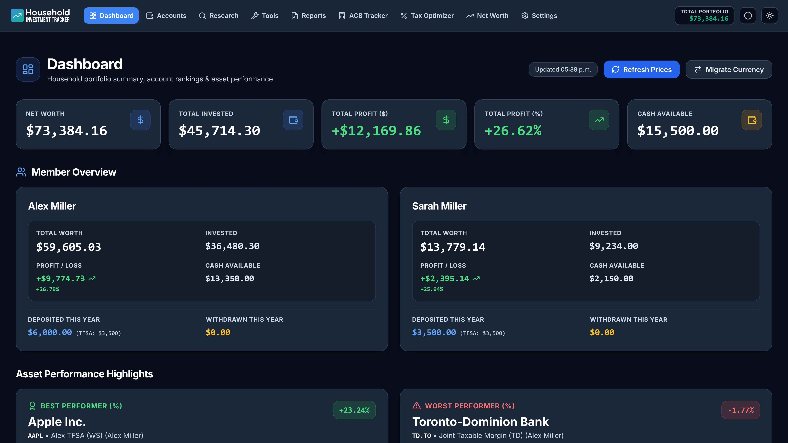
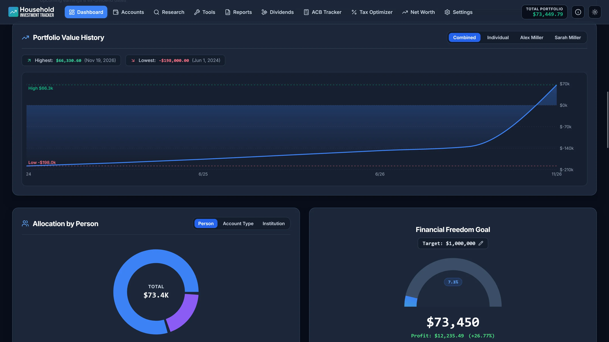
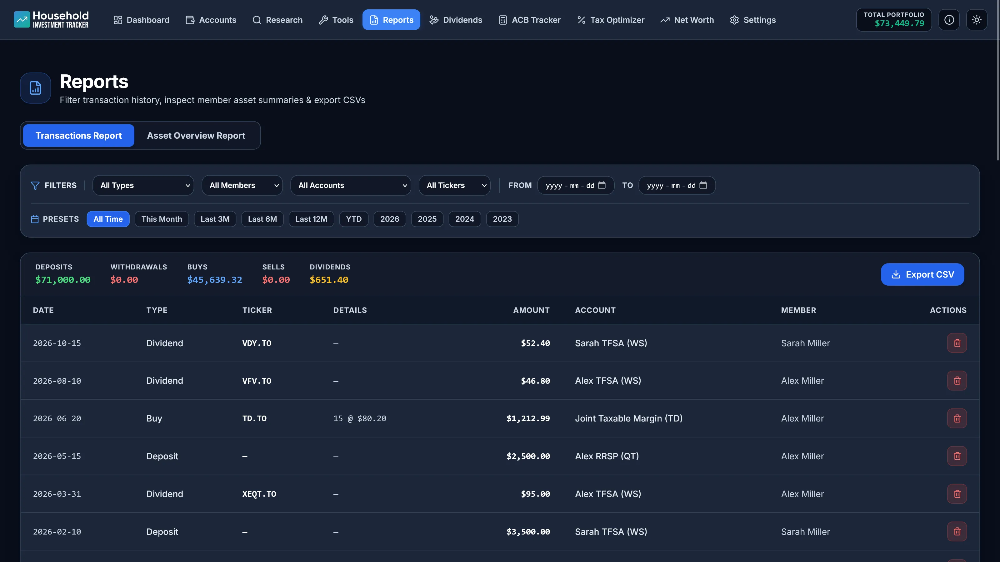
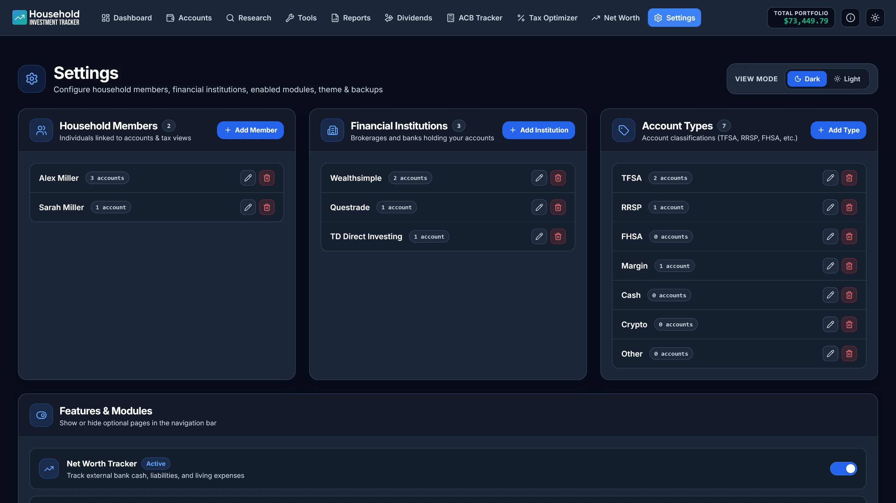

<div align="center">


<br />
<br />

[](https://react.dev/)
[](https://www.typescriptlang.org/)
[](https://vitejs.dev/)
[](https://tailwindcss.com/)
[](https://expressjs.com/)
[](https://www.electronjs.org/)
[](https://zod.dev/)
[](LICENSE)

**A privacy-first, local-first personal finance, portfolio analytics, and tax planning platform — built and optimized for Canadian investors.**

[Download (Windows)](#download-for-windows) • [Screenshots](#screenshots) • [Features](#features) • [Canadian Optimization](#-optimized-for-canadian-investors) • [Tech Stack](#technology-stack) • [Getting Started](#installation) • [Electron Build](#desktop-build--release-windows-exe) • [Backups & Security](#backup--data-management) • [Disclaimer](#️-disclaimer)

</div>

---

## Overview

**Household Investment Tracker** brings your entire household's financial picture into one fast, local-first workspace. Available as a standalone Windows desktop app or via local web server—with both **Dark** and **Light** themes—it lets you track holdings across multiple family members and brokerages, monitor live CAD/USD portfolio performance, run technical analysis with TradingView charts, calculate Adjusted Cost Base (ACB) for non-registered accounts, and simulate RRSP tax-bracket optimization — all without sending your financial data to third-party cloud servers.

---

## Download for Windows

No Node.js or terminal setup required — download and run the Windows installer directly:

* **[Download Household Investment Tracker v1.0.0 (.exe)](https://github.com/mwongr/household-investment-tracker/releases/download/v1.0.0/Household.Investment.Tracker.Setup.1.0.0.exe)**
* Browse all versions and release notes on the **[GitHub Releases page](https://github.com/mwongr/household-investment-tracker/releases)**.

---

## Screenshots

*Available in both **Dark** and **Light** themes.*

<table>
  <tr>
    <td align="center"><br /><sub><b>Dashboard</b></sub></td>
    <td align="center"><br /><sub><b>Accounts List</b></sub></td>
    <td align="center"><br /><sub><b>Account Holdings</b></sub></td>
  </tr>
  <tr>
    <td align="center"><br /><sub><b>Charts</b></sub></td>
    <td align="center"><br /><sub><b>Account Balancer</b></sub></td>
    <td align="center"><br /><sub><b>Account Tools</b></sub></td>
  </tr>
  <tr>
    <td align="center"><br /><sub><b>Reports</b></sub></td>
    <td align="center"><br /><sub><b>Dividends Dashboard</b></sub></td>
    <td align="center"><br /><sub><b>Stock Research</b></sub></td>
  </tr>
  <tr>
    <td align="center"><br /><sub><b>Research Chart</b></sub></td>
    <td align="center"><br /><sub><b>Net Worth Dashboard</b></sub></td>
    <td align="center"><br /><sub><b>Tax Optimizer</b></sub></td>
  </tr>
  <tr>
    <td align="center"><br /><sub><b>ACB Tracker</b></sub></td>
    <td align="center"><br /><sub><b>Investment Tools</b></sub></td>
    <td align="center"><br /><sub><b>Settings</b></sub></td>
  </tr>
</table>

---

## 🍁 Optimized for Canadian Investors

While flexible enough for general portfolio tracking, the app is purpose-built around Canadian investing workflows:
*   **Canadian Account Types**: Pre-configured for **TFSA**, **RRSP**, **FHSA**, **Margin**, **Cash**, and **Crypto** accounts (with custom type support).
*   **Native Brokerage CSV Parsers**: Direct activity and transaction import support for **Wealthsimple** and **Questrade**, alongside a custom CSV mapper for any institution.
*   **CAD / USD Dual-Currency Engine**: Live `CAD=X` exchange rate fetching with automatic CAD-normalized market values, book costs, and profit/loss calculations.
*   **CRA & Revenu Québec Tax Optimizer**: Models combined Federal & Provincial brackets (including the Quebec Abatement) to pinpoint the exact RRSP contribution "sweet spot" for maximum tax refunds.
*   **Canadian Capital Gains (ACB) Tracker**: Dedicated running Adjusted Cost Base ledger for non-registered accounts, handling Return of Capital (RoC), Capital Gains Dividends, DRIPs, and Stock Splits.
*   **Canadian Dividend & Withholding Tax Intelligence**: Tracks US-listed dividend payers across **TFSA/FHSA** (15% non-recoverable US withholding tax) vs. **RRSP/Spousal RRSP/LIRA/RRIF** (treaty-exempt), and uses Trailing 12-Month (TTM) and local transaction-history fallbacks for uneven `.TO` ETF distributions.

---

## Features

### Portfolio Dashboard & Management
*   **Household Overview**: Real-time tracking of net worth, daily gains/losses, portfolio value history, and allocation breakdowns by member, account type, and institution.
*   **Multi-Member & Institution Support**: View individual family member portfolios or aggregate the entire household.
*   **Asset Management**: Detailed tracking for Stocks, ETFs, Mutual Funds, and Cash with custom book cost overrides and currency migration tools.
*   **Live Market Data & Watchlist**: Yahoo Finance integration for quotes, daily changes, 52-week ranges, volume, sparklines, and upcoming earnings/dividend events.
*   **Onboarding Wizard & Demo Mode**: Guided first-run setup plus a one-click Demo Mode populated with sample household data.
*   **Dark & Light Themes**: Full theme support toggled directly from the navigation bar.

### CSV Import & Data Portability
*   **Wealthsimple & Questrade**: Zero-reformatting import for exported transaction histories.
*   **Custom CSV Mapper**: Interactive column mapping for holdings and transactions from any brokerage, complete with downloadable templates, validation previews, and duplicate detection.

### Portfolio Balancer & Calculators
*   **Portfolio Balancer**: Define target allocation percentages per holding, spot drift immediately, and generate a buy/sell rebalancing action plan.
*   **Average Down Calculator**: Simulate additional share purchases to preview new average cost, capital required, and break-even recovery targets.

### Dividends & Passive Income Analytics
*   **KPI Strip**: At-a-glance **YTD Dividends Received** (Cash + DRIP split), **Projected Annual Income**, **Average Monthly Income**, and weighted **Portfolio Yield & Yield on Cost (YoC)** normalized to CAD.
*   **Payouts History Chart**: Interactive Recharts bar chart with **Current Year**, **Year-over-Year (YoY)**, and **Annual (All Years)** toggles, plus Cash vs. Reinvested (DRIP) tooltip breakdowns.
*   **Income by Holding & Concentration**: Sortable table with **By Ticker** and **By Account** views, inline % share bars, and automatic concentration alerts when a single ticker or top 3 tickers dominate passive income.
*   **Account & Canadian Tax Breakdown**: Groups projected and YTD income by account type with **US 15% withholding** (TFSA/FHSA) and **US treaty exempt** (RRSP/Spousal RRSP/LIRA/RRIF) indicators.
*   **Upcoming Payouts Calendar (30d / 60d)**: Tracks upcoming ex-dividend and pay dates with **Confirmed** (Yahoo Finance) vs. **Estimated** (TTM / historical cadence fallback for `.TO` ETFs) badges.

### RRSP Tax Bracket Optimizer
*   **Bracket Drop Optimization**: Models combined Federal and Provincial tax brackets with customizable rates and regional abatements.
*   **"Sweet Spot" & Slider Simulation**: Live feedback on Federal (CRA) and Provincial (Revenu Québec) refunds, effective tax savings rate, and marginal bracket drops.
*   **Funding Schedule & Snapshots**: Link an RRSP account to track YTD deposits, calculate periodic contributions needed before the deadline, and save/compare scenario snapshots.

### Adjusted Cost Base (ACB) Tracker
*   **Full Transaction Support**: Tracks Buy, Sell, Return of Capital (RoC), Capital Gains Dividend, Reinvested Dividend (DRIP), Reinvested Capital Gains Distribution, and Stock Splits.
*   **Running Ledger & Export**: Computes running share counts, total ACB, ACB per share, and realized capital gains/losses by tax year with one-click CSV export.

### Stock Research & Technical Analysis
*   **Interactive Candlestick Charts**: Powered by TradingView's `lightweight-charts` with overlaid **EMA 50 / EMA 200** lines.
*   **Indicators & Signals**: Automated **RSI (14)**, **MACD (12, 26, 9)**, **ATR (14)**, **Golden Cross** detection, **Bollinger Bands**, and **61.8% Fibonacci** entry targets.
*   **Multi-Ticker Comparison**: Normalized percentage return comparison (dividend-adjusted) for up to 8 tickers across `1M`, `6M`, `1Y`, `5Y`, and `YTD`.

### Net Worth & Cashflow Dashboard
*   **Complete Balance Sheet**: Track bank accounts (chequing/savings) and liabilities (mortgages, credit cards, loans) alongside investments.
*   **Debt-to-Asset & Passive Income**: Visual asset/cash/debt breakdown plus a 4% safe-withdrawal-rate passive income vs. monthly expense projection.
*   **PDF & CSV Exports**: Generate print-ready PDF balance sheets (`jsPDF` + `html2canvas`) or export raw data to CSV (`PapaParse`).

### Investment Tools Suite
*   **Stock Buying Planner**: Preview cash balance and average cost impact before placing trades.
*   **Profit/Loss & Risk-Reward Calculator**: Model entry, target, and stop-loss levels with an "Auto 1:2" helper.
*   **Position Sizing Calculator**: Risk-based share sizing with live ATR volatility stop-loss suggestions.
*   **Allocation Splitter & DRIP Simulator**: Split cash across custom asset weights and project dividend reinvestment compounding up to 50 years.

---

## Technology Stack

| Layer | Technologies |
| :--- | :--- |
| **Desktop** | Electron 45, `electron-builder`, `electron-updater`, `esbuild` |
| **Frontend** | React 19, TypeScript, Vite 7, React Router 7 |
| **Charts & UI** | TradingView Lightweight Charts, Recharts, Tailwind CSS, Lucide Icons |
| **Reporting & CSV** | jsPDF, html2canvas, PapaParse |
| **Backend** | Node.js, Express 5, TypeScript (`tsx`), Zod, Helmet, express-rate-limit |
| **Market & TA Data** | `yahoo-finance2` (with rate-limiting & TTL caching), `technicalindicators` |
| **Storage** | Local JSON (`server/database.json` or `%APPDATA%\Household Investment Tracker\database.json`) with atomic writes & rolling snapshots |
| **Testing** | Vitest |

---

## Prerequisites

*   **Windows Installer**: Windows 10/11 (64-bit) — no additional prerequisites required.
*   **Running / Building from Source**: **[Node.js](https://nodejs.org/)** (v20 or higher recommended). `Start App.bat` is for Windows *(macOS and Linux are supported via `npm run dev`)*.

---

## Installation

### Option 1: Windows Installer (Recommended)
1. Download the installer: **[Household.Investment.Tracker.Setup.1.0.0.exe](https://github.com/mwongr/household-investment-tracker/releases/download/v1.0.0/Household.Investment.Tracker.Setup.1.0.0.exe)** (also available on the **[Releases page](https://github.com/mwongr/household-investment-tracker/releases)**).
2. Run the `.exe` installer and follow the setup wizard.
3. Launch **Household Investment Tracker** from your Desktop or Start Menu.

### Option 2: Run from Source
1. **Clone the repository**:
   ```bash
   git clone https://github.com/mwongr/household-investment-tracker.git
   ```

2. **Navigate into the project directory**:
   ```bash
   cd household-investment-tracker
   ```

3. **Install dependencies**:
   ```bash
   npm install
   ```

---

## How to Run (From Source)

### Option 1: Windows Easy Start
Double-click `Start App.bat` in the project root.
* Launches the Express API server (`127.0.0.1:3001`) and the Vite frontend (`localhost:5847`) concurrently.
* Prompts to create a timestamped backup when you stop the app.

### Option 2: Command Line
```bash
npm run dev
```
Open **[http://localhost:5847](http://localhost:5847)** in your browser.

### Available Scripts
| Command | Description |
| :--- | :--- |
| `npm run dev` | Starts both the backend server and Vite dev server |
| `npm run electron:dev` | Launches the app inside Electron in development mode |
| `npm run build` | Type-checks and builds the frontend production bundle to `dist/` |
| `npm run build:electron` | Builds the frontend (`dist/`) and bundles Electron + server (`dist-electron/`) |
| `npm run dist` | Builds and packages the Windows `.exe` installer locally into `release/` |
| `npm run release` | Builds and publishes the Windows `.exe` installer to GitHub Releases |
| `npm run typecheck` | Runs strict TypeScript checks for frontend, server, and Electron |
| `npm test` | Runs the Vitest unit and route test suite |
| `npm run lint` | Runs ESLint across `src/` and `server/` |

---

## Backup & Data Management

### Automated Backups
1. Open **Settings** in the app.
2. Set your **Automated Backup Location** to a local folder (e.g., `D:\Backups`).
3. When exiting `Start App.bat`, confirm the backup prompt to save a timestamped JSON copy.
4. The server also maintains rolling pre-write snapshots in `server/backups/` (gitignored).

### Manual Import / Export
* **Export**: Download a full JSON snapshot anytime from **Settings**.
* **Restore**: Import a previously saved JSON backup from **Settings**.

---

## 🔒 Privacy & Local Security

* **Local-First Storage**: All portfolio, tax, and net worth data stays on your machine in `server/database.json` (gitignored by default) for DIY runs, or `%APPDATA%\Household Investment Tracker\database.json` in the packaged Windows `.exe`. Nothing is uploaded to a remote database.
* **Hardened Local Server**: The Express backend binds strictly to `127.0.0.1`, enforces localhost-only CORS, applies `helmet` security headers and rate limiting, validates all payloads and backup paths with `zod`, and uses serialized atomic file writes to prevent corruption.

---

## Desktop Build & Release (Windows `.exe`)

Make sure you have cloned the repository and run `npm install` first.

1. **Run in Electron (Development)**:
   ```bash
   npm run electron:dev
   ```
   Starts the Vite dev server, bundles the Electron main/preload/server code into `dist-electron/`, and opens the desktop window.

2. **Build the Windows Installer (`.exe`) Locally**:
   ```bash
   npm run dist
   ```
   Compiles the frontend (`dist/`), bundles Electron and the Express backend (`dist-electron/`), and packages the NSIS installer into `release/Household Investment Tracker Setup <version>.exe` without publishing.

3. **Publish a Release to GitHub** *(Maintainers)*:
   Set `GH_TOKEN` (with `repo` scope), bump `version` in `package.json`, and run:
   ```bash
   npm run release
   ```

---

## ⚠️ Disclaimer

**For Informational & Educational Purposes Only — Not Financial, Tax, or Legal Advice.**

* This software is a personal tracking and calculation tool. Nothing in this application constitutes investment, financial, tax, accounting, or legal advice, nor is it a recommendation to buy, sell, or hold any security.
* **Market Data**: Quotes, historical prices, exchange rates, and technical indicators are fetched from third-party sources (Yahoo Finance) and may be delayed, incomplete, or inaccurate.
* **Tax & ACB Calculations**: Tax bracket estimates, RRSP refund projections, and Adjusted Cost Base (ACB) calculations are approximations based on user-entered data and configurable rates. Canadian tax rules (including superficial loss rules, spousal attribution, and provincial surtaxes) are complex—always verify figures with official CRA / Revenu Québec documentation or a qualified financial/tax professional before filing or making investment decisions.
* **Use at Your Own Risk**: The author assumes no responsibility or liability for any financial losses, tax penalties, data loss, or decisions made based on the output of this application.

---

## License

This project is licensed under the **Creative Commons Attribution-NonCommercial 4.0 International (CC BY-NC 4.0)** license.

* **Allowed**: View, download, run, share, and adapt the code for personal, educational, and non-commercial purposes with proper attribution.
* **Prohibited**: **Commercial use is strictly forbidden.** You may not sell, resell, bundle into commercial products, offer as a paid/SaaS service, or monetize this software in any manner without prior express written consent.

See the [LICENSE](LICENSE) file or [Creative Commons BY-NC 4.0](https://creativecommons.org/licenses/by-nc/4.0/) for full legal terms.
